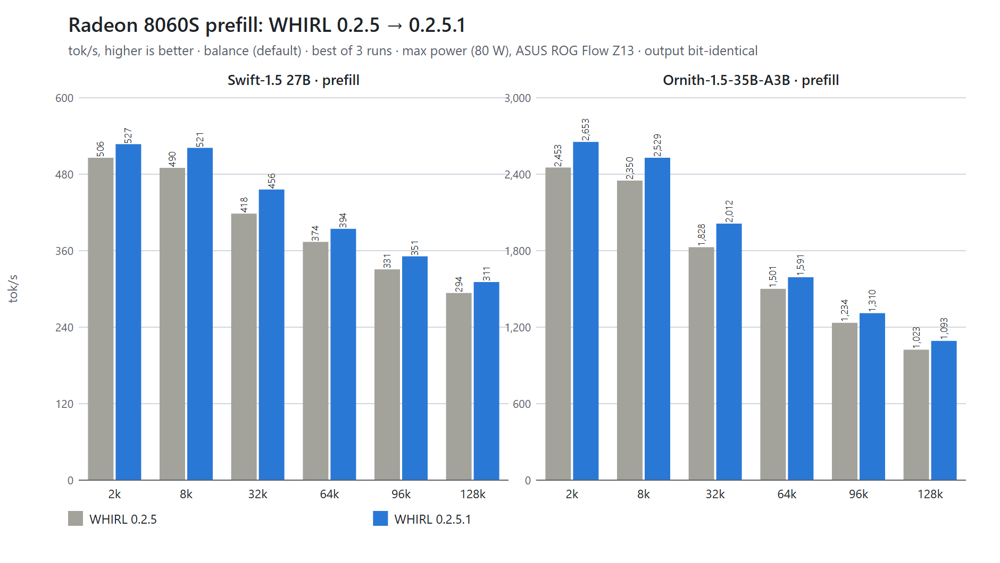
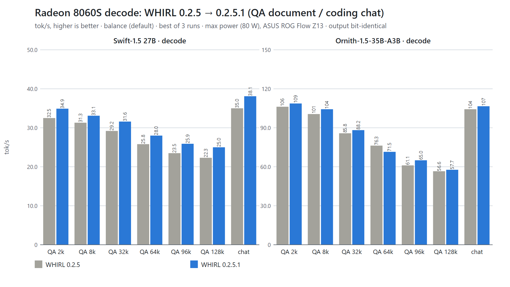
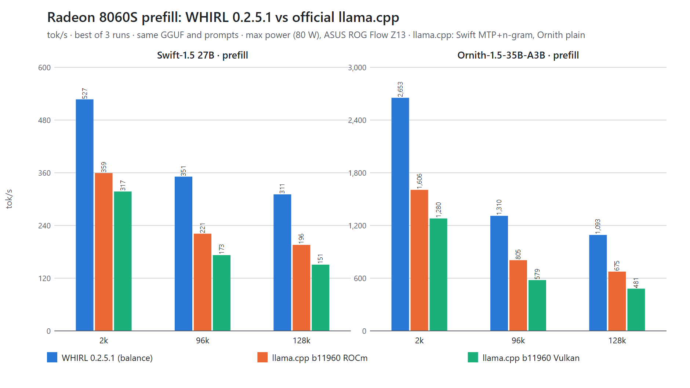
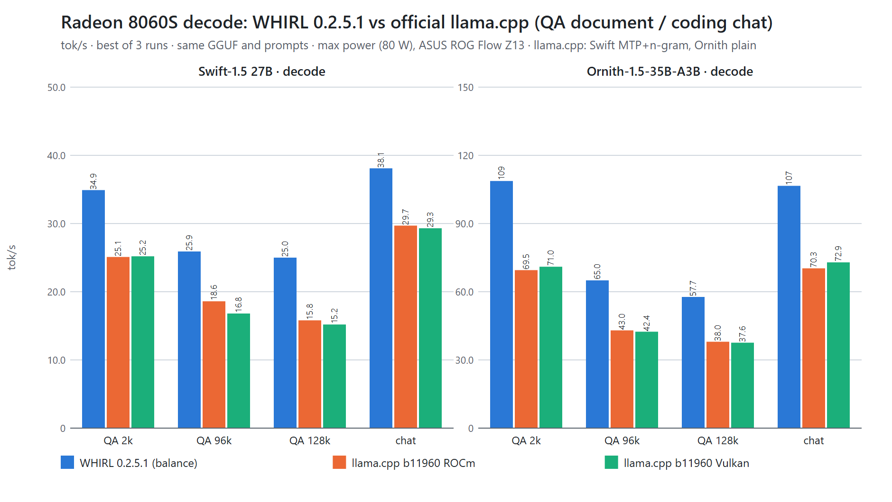
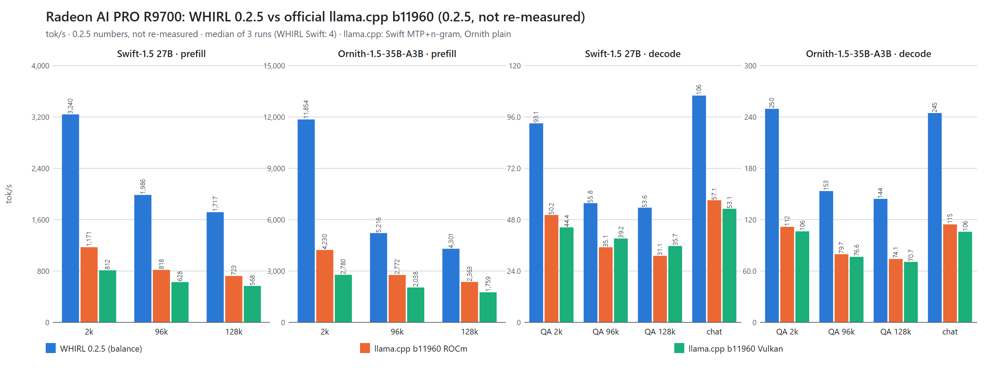

[English](../README.md) | **繁體中文**

# WHIRL

**Windows HIP Inference for RDNA LLMs**

> ### WHIRL 0.2.5.1：Radeon 8060S 更快了
> 0.2.5.1 是 **Radeon 8060S**（AMD Ryzen AI Max+ 395）的速度更新：五項新的 8060S kernel 路徑讓兩個模型在三種模式下的預填都快了 **+2% 到 +10%**，Swift-1.5 27B 在 balance 與 fast 的解碼（2k 到 128k 文件問答，balance 另含寫程式對話）快了 **+4% 到 +12%**，而且在 8060S 上每種模式的輸出都與 0.2.5 逐位元相同。對官方 llama.cpp 發布版 **b11960**（v0.8.0，2026-10-28）的 ROCm 版與 Vulkan 版，WHIRL 預設模式（balance）在 8060S 每個量過的格子都領先（2k、96k、128k token 提示的預填與解碼，以及寫程式對話）：Swift-1.5 27B 對 ROCm 快 +28% 到 +59%、對 Vulkan 快 +30% 到 +106%，Ornith-1.5-35B-A3B 分別快 +51% 到 +65% 與 +46% 到 +127%。Radeon 8060S 的數字為最大功率（80 W），ASUS ROG Flow Z13，GPU 記憶體（UMA frame buffer）64 GB，WHIRL 與 llama.cpp 相同，每格 3 次取最佳；受 Z13 功耗限制，數據略有浮動。
>
> R9700 的 GPU 程式與 0.2.5 相同（比對過編譯出的 R9700 kernel，只差內部建置編號），數字沿用 0.2.5、未重新量測：Swift-1.5 27B 對 ROCm 快 +59% 到 +177%、對 Vulkan 快 +42% 到 +299%，Ornith-1.5-35B-A3B 分別快 +82% 到 +180% 與 +100% 到 +326%（3 次中位數，WHIRL 的 Swift-1.5 27B 為 4 次）。[0.2.5.1 更新內容](#0251-更新內容)。

WHIRL 是 Windows 上 AMD GPU 的開源（Apache-2.0）LLM 推論引擎：原生 C++／HIP，每一支 kernel 都公開，不需要 WSL、Docker，也不用安裝 ROCm。**下載 zip、解壓縮、執行，只需要 AMD 驅動。** 支援 **AMD Ryzen AI Max+ 395** 的 **Radeon 8060S** 與 **AMD Radeon AI PRO R9700**（RDNA 4，32 GB），搭配我們的兩個 MXFP4 模型：**Swift-1.5 27B MXFP4**（稠密）與 **Ornith-1.5-35B-A3B MXFP4**（MoE）。兩張卡上，WHIRL 的預設模式都**比官方 llama.cpp 發布版 b11960（v0.8.0）快**，ROCm 與 Vulkan 版皆然，每個量過的提示長度都是如此；0.2.5.1 讓 Radeon 8060S 又更快。WHIRL 0.2.0 對 llama.cpp b11214 時，三種模式、2k 到 ~250k token 的每個提示長度都領先（0.2.0 的表格在下方）。

## 快速上手

1. 從 [Releases](https://github.com/tsaipifong/whirl-llm/releases) 下載 `whirl-0.2.5.1-windows-x64.zip`，以及一個模型，例如 [`Swift-1.5-Qwen3.8-27B-MXFP4-A-outQ6_K.gguf`](https://huggingface.co/tsaipifong/Swift-1.5-Qwen3.8-27b-MXFP4-GGUF)，存到 `C:\models\`。只需要 AMD 驅動（[需求](#需求)；Radeon 8060S 請先設定 GPU 記憶體）。
2. 解壓縮後執行，在 PowerShell：

```powershell
Unblock-File .\whirl-0.2.5.1-windows-x64.zip
Expand-Archive .\whirl-0.2.5.1-windows-x64.zip -DestinationPath C:\whirl
cd C:\whirl\whirl-0.2.5.1-windows-x64
.\whirl.exe devices                                    # 應列出 Radeon 8060S（gfx1151）和／或 R9700（gfx1201）
.\whirl.exe chat C:\models\Swift-1.5-Qwen3.8-27B-MXFP4-A-outQ6_K.gguf "用兩句話解釋 TCP slow start。" --max-tokens 400
.\whirl-server.exe C:\models\Swift-1.5-Qwen3.8-27B-MXFP4-A-outQ6_K.gguf --port 8080      # 預設模式：balance
```

server 在 `http://127.0.0.1:8080/v1` 提供 OpenAI API（`/v1/chat/completions`、`/v1/completions`、`/v1/models`、`/health`），任何相容 OpenAI 的用戶端都能用。加 `--precise` 得到逐位元無損輸出，加 `--fast` 追求最高速度。用 Ctrl+C 停止 server，會先把重複使用過的工作階段寫進 SSD 層。

長文件可加大每個 slot 的上下文，例如 `--ctx-per-slot 262144`；見 [recipes_zh-TW.md](recipes_zh-TW.md#long-context)。

### 選擇 GPU

- 沒加 `--device` 時，WHIRL 使用 GPU 記憶體最大的那張（內顯以專用記憶體計算；一樣大時，選 `--list-devices`
  列出的第一張），啟動紀錄會寫出用的是哪張。
- 要改用別張，請加 `--device pci:匯流排:裝置`，號碼可在工作管理員 →「效能」→ 選顯示卡 →「實體位置」查到。
- 例如：工作管理員顯示實體位置為「PCI 匯流排 71，裝置 0，函數 0」→ `whirl-server.exe <模型.gguf> --device pci:71:0`

`-dev` 和環境變數 `WHIRL_DEVICE` 的作用與 `--device` 相同（`whirl` 與 `whirl-server` 都適用）。

`whirl devices`（或 `--list-devices`）會列出每張卡的 `pci:` 編號。只有一張卡符合時，也可以用編號、`r9700`、
`8060s` 或名稱的一部分。USB4／Thunderbolt 外接顯卡在接上時才分配匯流排編號，重新插拔後請再看一次工作管理員。

每個模型第一次執行時會調校一次 GPU kernel，結果快取在 `%LOCALAPPDATA%\whirl`（R9700 上我們的 MXFP4 檔只要幾秒；8060S 較久）。完整步驟：[快速上手](quickstart_zh-TW.md)。所有選項：[使用參考](guide/zh-TW/usage.md)。

**進階：從原始碼建置**——給想自己修改、調校 WHIRL 的使用者：[building_zh-TW.md](building_zh-TW.md)。

## WHIRL 對 llama.cpp：一眼看

**Radeon 8060S，WHIRL 0.2.5.1** 對 WHIRL 0.2.5，以及對 ggml-org 官方 llama.cpp 發布版 **b11960**，**ROCm** 與 **Vulkan** 兩個版本分開列：WHIRL 預設模式（balance）、同一個 GGUF 檔、同一組提示、greedy 解碼、一個使用者。**最大功率（80 W），ASUS ROG Flow Z13**；8060S 每格都是 3 次取最佳。









- **Radeon 8060S，0.2.5.1 對 0.2.5**（balance，最大功率（80 W），ASUS ROG Flow Z13）：Swift 27B 寫程式對話解碼 35.0 → **38.1 tok/s**（+8.9%），128k token 文件問答 22.3 → 25.0（+12.1%）；32k 預填 418.1 → 456.0（+9.1%）。Ornith 35B-A3B 2k 預填 2,453 → **2,653 tok/s**（+8.2%），32k 1,828 → 2,012（+10.1%）。
- **Radeon 8060S 對 llama.cpp b11960**（ROCm／Vulkan）：128k token 提示的預填，Swift 310.9 對 195.8／150.9 tok/s，Ornith 1,093 對 674.8／481.0；寫程式對話，Swift 38.1 對 29.7／29.3，Ornith 106.6 對 70.3／72.9。
- **R9700**（沿用 0.2.5 的數字，GPU 程式相同）：Ornith 35B-A3B 讀 2k token 提示 **11,854 tok/s**（llama.cpp ROCm 4,230、Vulkan 2,780）；Swift 27B 寫程式對話解碼 106.0 tok/s（57.1／53.1）。

**Radeon 8060S**（gfx1151，Ryzen AI Max+ 395），**最大功率（80 W），ASUS ROG Flow Z13**，WHIRL 0.2.5.1 balance（預設），每格 3 次取最佳。llama.cpp 每一格括號裡的百分比，是 WHIRL 領先該格的幅度；「對 0.2.5」是與同一台機器、同一量法的 WHIRL 0.2.5 相比的變化。

| tok/s，越高越好 | Swift 27B：WHIRL | llama.cpp ROCm | llama.cpp Vulkan | Ornith 35B-A3B：WHIRL | llama.cpp ROCm | llama.cpp Vulkan |
|---|---|---|---|---|---|---|
| 預填，2k token 提示 | **527.2** (+4.2% 對 0.2.5) | 359.3 (WHIRL +47%) | 317.3 (WHIRL +66%) | **2,653** (+8.2% 對 0.2.5) | 1,606 (WHIRL +65%) | 1,280 (WHIRL +107%) |
| 預填，96k token 提示 | **351.1** (+6.2% 對 0.2.5) | 221.3 (WHIRL +59%) | 172.5 (WHIRL +104%) | **1,310** (+6.1% 對 0.2.5) | 804.7 (WHIRL +63%) | 578.5 (WHIRL +126%) |
| 預填，128k token 提示 | **310.9** (+5.9% 對 0.2.5) | 195.8 (WHIRL +59%) | 150.9 (WHIRL +106%) | **1,093** (+6.8% 對 0.2.5) | 674.8 (WHIRL +62%) | 481.0 (WHIRL +127%) |
| 解碼，2k token 文件問答 | **34.9** (+7.4% 對 0.2.5) | 25.1 (WHIRL +39%) | 25.2 (WHIRL +38%) | **108.7** (+2.4% 對 0.2.5) | 69.5 (WHIRL +56%) | 71.0 (WHIRL +53%) |
| 解碼，96k token 文件問答 | **25.9** (+10.2% 對 0.2.5) | 18.6 (WHIRL +39%) | 16.8 (WHIRL +54%) | **65.0** (+6.4% 對 0.2.5) | 43.0 (WHIRL +51%) | 42.4 (WHIRL +53%) |
| 解碼，128k token 文件問答 | **25.0** (+12.1% 對 0.2.5) | 15.8 (WHIRL +58%) | 15.2 (WHIRL +64%) | **57.7** (+1.9% 對 0.2.5) | 38.0 (WHIRL +52%) | 37.6 (WHIRL +53%) |
| 解碼，寫程式對話（全新撰寫） | **38.1** (+8.9% 對 0.2.5) | 29.7 (WHIRL +28%) | 29.3 (WHIRL +30%) | **106.6** (+2.2% 對 0.2.5) | 70.3 (WHIRL +52%) | 72.9 (WHIRL +46%) |

**Radeon AI PRO R9700**（gfx1201，32 GB）。0.2.5.1 的 R9700 GPU 程式與 0.2.5 相同（比對過編譯出的 R9700 kernel：除了內部建置編號之外完全相同），所以這裡是 **0.2.5 公布的數字，未重新量測**：WHIRL balance，每格 3 次中位數（WHIRL 的 Swift 27B 為 4 次），對同一個 llama.cpp b11960。



| tok/s，越高越好 | Swift 27B：WHIRL | llama.cpp ROCm | llama.cpp Vulkan | Ornith 35B-A3B：WHIRL | llama.cpp ROCm | llama.cpp Vulkan |
|---|---|---|---|---|---|---|
| 預填，2k token 提示 | **3,240** | 1,171 (WHIRL +177%) | 811.5 (WHIRL +299%) | **11,854** | 4,230 (WHIRL +180%) | 2,780 (WHIRL +326%) |
| 預填，96k token 提示 | **1,986** | 817.6 (WHIRL +143%) | 627.9 (WHIRL +216%) | **5,216** | 2,772 (WHIRL +88%) | 2,038 (WHIRL +156%) |
| 預填，128k token 提示 | **1,717** | 723.1 (WHIRL +137%) | 567.6 (WHIRL +202%) | **4,301** | 2,363 (WHIRL +82%) | 1,759 (WHIRL +144%) |
| 解碼，2k token 文件問答 | **93.1** | 50.2 (WHIRL +85%) | 44.4 (WHIRL +110%) | **249.5** | 111.7 (WHIRL +123%) | 106.3 (WHIRL +135%) |
| 解碼，96k token 文件問答 | **55.8** | 35.1 (WHIRL +59%) | 39.2 (WHIRL +42%) | **153.4** | 79.7 (WHIRL +92%) | 76.6 (WHIRL +100%) |
| 解碼，128k token 文件問答 | **53.6** | 31.1 (WHIRL +72%) | 35.7 (WHIRL +50%) | **144.3** | 74.1 (WHIRL +95%) | 70.7 (WHIRL +104%) |
| 解碼，寫程式對話（全新撰寫） | **106.0** | 57.1 (WHIRL +86%) | 53.1 (WHIRL +100%) | **244.6** | 114.5 (WHIRL +114%) | 105.9 (WHIRL +131%) |

各列量的是什麼（確切提示與指令：[benchmarks.md](guide/zh-TW/benchmarks.md#prompts)）：

- **Prefill**：處理該長度長文件提示的速度。
- **Decode，文件問答**：每個長度問同一個問題（說明文件開頭附近引用的一個函式，並寫出修正版，256 token）。部分回答可以照抄提示裡的程式碼，這對每個使用投機草稿的引擎都有幫助。
- **Decode，寫程式對話（全新撰寫）**：一個寫程式問題，回答（說明與程式碼）全部是新寫的，提示裡沒有可照抄的內容，對投機草稿是困難的情況。512 token。
- **各引擎怎麼解碼**：WHIRL 用自己的 MTP（+ n-gram）草稿。llama.cpp 在 Swift 27B 用 MTP + n-gram（`--spec-type draft-mtp,ngram-mod`），是它在這個模型上最快的模式；在 Ornith **不用**投機解碼，因為我們量到它的 MTP 在這個 MoE 模型上比一般解碼慢。所以 Ornith 的 decode 列是兩邊**各自出廠設定**的對比，不是同條件對比。
- **8060S 各格怎麼量**：每格 3 次取最佳，WHIRL 0.2.5.1 與 WHIRL 0.2.5 用同一量法、同一組提示、同一台機器（0.2.5 發布說明印的是同一批 0.2.5 量測的中位數，所以和這裡的 0.2.5 數字略有不同）。llama.cpp b11960 各格沿用 0.2.5 時在這台機器、用同一組模型檔量的結果（llama.cpp 沒有變），3 次取最佳；Swift 27B 的 Vulkan 2k 兩格為 0.2.5.1 重新量測。llama.cpp 的 ROCm 版照官方原樣執行，使用它資料夾裡自帶的 HIP runtime DLL（`amdhip64_7.dll` 10.0.3581.0）；WHIRL 使用驅動安裝的版本（10.0.3683.0）。Swift-1.5 27B 的 precise 解碼路徑在 0.2.5.1 沒有改，它每個解碼步驟的速度與 0.2.5 相差 -1.2% 到 +0.9%，表示機器狀態相同。
- **有草稿的解碼速度會隨文字變動**：每次接受多少 MTP 草稿取決於該次寫出的文字（文件提示的第一行每次不同），所以單一解碼格在兩次量測間可能相差幾個百分點；Ornith 各格的說明見 [0.2.5.1 更新內容](#0251-更新內容)。

### 真實的 coding agent 工作階段

*0.2.0 的量測（WHIRL 0.2.0 對 llama.cpp b11214），之後沒有重新量測。*

Swift 27B，WHIRL balance。一段工作階段＝約 20k token 的系統＋工具提示（coding agent 指示加上 skills／MCP 工具手冊）、一次 `read_file` 工具呼叫回傳約 3.6k token 的 C++ 原始檔，接著四輪使用者提問（說明這個檔案、找出最複雜的函式、改寫該函式、審查使用者送來的修改版），每次呼叫都重送完整歷史，每個回答最多 384 token。測試資料在 repo 裡（[benchmarks.md §6](guide/zh-TW/benchmarks.md#agent-session)）。

**Radeon 8060S**（最大功率（80 W），ASUS ROG Flow Z13）：

<!-- gen:agent.s8.zh -->
| 工作階段（總時間） | WHIRL balance | llama.cpp ROCm | llama.cpp Vulkan | WHIRL 比 ROCm／Vulkan 省下的時間 | 模型呼叫次數 WHIRL／ROCm／Vulkan |
|---|---|---|---|---|---|
| 冷啟動：20k token 的系統＋工具提示尚未快取 | **95.7 秒** | 145.6 秒 | 264.4 秒 | 34% / 64% | 6/6/6 |
| 第二段：共用同一個前綴，處理另一個檔案 | **44.9 秒** | 66.2 秒 | 196.8 秒 | 32% / 77% | 5/5/6 |
<!-- /gen -->

**R9700：**

<!-- gen:agent.r97.zh -->
| 工作階段（總時間） | WHIRL balance | llama.cpp ROCm | llama.cpp Vulkan | WHIRL 比 ROCm／Vulkan 省下的時間 | 模型呼叫次數 WHIRL／ROCm／Vulkan |
|---|---|---|---|---|---|
| 冷啟動：20k token 的系統＋工具提示尚未快取 | **17.0 秒** | 81.0 秒 | 69.4 秒 | 79% / 76% | 5/6/6 |
| 第二段：共用同一個前綴，處理另一個檔案 | **11.8 秒** | 60.9 秒 | 38.0 秒 | 81% / 69% | 6/5/6 |
<!-- /gen -->

每個引擎寫出自己的回答，所以模型呼叫次數不同（最後一欄：重讀一次檔案的引擎會多一次呼叫）。每格單次量測。

## 為什麼 WHIRL 跑這些 MXFP4 檔特別快

我們的 MXFP4 檔是為 WHIRL 量化的，WHIRL 也有專為它們寫的 kernel：

<!-- gen:why.zh -->
- **R9700 上的 fp8 prefill**（balance 與 fast）：prefill 的 MXFP4 矩陣乘法跑在 RDNA 4 的 fp8 矩陣單元上（0.2.0 的量測，Swift 27B 2k：3,273 tok/s，precise 不用 fp8 為 1,702）。8060S 沒有 fp8 單元，走一般路徑。
- **`ssm_alpha`／`ssm_beta` 用 Q8_0**（而不是 F32）：單 token decode 與多 token 的 MTP 驗證因此走同一個融合 kernel，MTP 輸出與單純 greedy 解碼逐位元相同，草稿也維持夠長。
- **Q6_K 輸出頭**：WHIRL 草稿步驟最快的輸出頭（每個草稿 token 都要經過 24.8 萬列的輸出頭）。
<!-- /gen -->

每一支 kernel 都在這個 repo 開源，沒有封閉元件，執行時也不會另外下載。

## 需求

| | |
|---|---|
| **下載就能跑** | 從 [Releases](https://github.com/tsaipifong/whirl-llm/releases) 下載 **`whirl-0.2.5.1-windows-x64.zip`**，解壓縮、執行。**只需要 AMD 驅動**：不需要 HIP SDK、ROCm，也不用另外安裝 Visual C++ 可轉散發套件（ROCm 10.1 驅動需要的幾個執行階段 DLL 已附在 zip 裡） |
| 安裝資料夾 | **WHIRL 資料夾請放在短路徑**（例如 `C:\whirl`）：安裝資料夾路徑上限 **150 位元組**（UTF-8：英數字每字 1、中文每字 3，全中文約 49 字），超過 WHIRL 會顯示訊息並拒絕啟動。模型等你指定的檔案沒有額外上限；SSD 快取資料夾（`--kv-ssd-dir`）最長 217 字元 |
| 驅動 | **AMD Software: Adrenalin Edition 26.8.1（驅動 32.0.31041.1004）或更新版**，兩張卡都一樣。更舊的版本未測試。使用 Adrenalin Edition for ROCm 10.1 驅動時，請讓 zip 裡的 `rocm_kpack.dll` 留在 `whirl.exe` 旁邊（該驅動的 GPU runtime 需要它，但驅動沒有安裝它），連同它用到的 Visual C++ 執行階段 DLL（`msvcp140.dll`、`vcruntime140.dll`、`vcruntime140_1.dll`，同樣附在 zip 裡） |
| GPU | **Radeon 8060S**（RDNA 3.5，gfx1151，AMD Ryzen AI Max+ 395 內顯）或 **AMD Radeon AI PRO R9700**（RDNA 4，gfx1201，32 GB）；一個行程用一張 GPU |
| Radeon 8060S：GPU 記憶體 | **先在 Armoury Crate 或 BIOS 設定 GPU 記憶體（UMA frame buffer 大小）**（其他筆電：AMD Software 的 *Variable Graphics Memory*），再重新開機。WHIRL 把模型、緩衝區和 KV 快取放在這塊專用記憶體；Windows 的「共用 GPU 記憶體」不拿來放這些（token 嵌入表和 RAM 快取層放在鎖定的系統 RAM，工作管理員會把它顯示成共用 GPU 記憶體）。**Swift-1.5 27B MXFP4 至少設 40 GB**（precise 模式搭配預設 KV 快取要 48 GB），**Ornith-1.5-35B-A3B MXFP4 至少 32 GB**（128 GB 的機器設 64 GB，任一模型、任一模式都能跑）。以 server 預設值量測（4 個 slot、262,144 token 的 KV 快取）：Swift 在 balance 用 29.9 GiB、fast 31.0 GiB、precise 38.2 GiB；Ornith 在 balance 與 precise 用 27.3 GiB、fast 23.4 GiB。設得比這少時，server 會縮小 KV 快取，或停下來並告訴你要設多大。`whirl devices` 會以「dedicated」顯示目前的大小 |
| 作業系統 | Windows 11 64 位元 |
| 模型 | Hugging Face 上的 [Swift-1.5 27B MXFP4](https://huggingface.co/tsaipifong/Swift-1.5-Qwen3.8-27b-MXFP4-GGUF) 或 [Ornith-1.5-35B-A3B MXFP4](https://huggingface.co/tsaipifong/Ornith-1.5-35B-A3B-MXFP4-GGUF)（[支援的模型](#支援的模型)） |
| 記憶體／磁碟 | server 會鎖定一部分主記憶體作 RAM 快取層（Radeon 8060S：Windows 看得到的 RAM 的 1/8，64 GB 機器為 8 GiB，低於 32 GB 則關閉；R9700 主機：約 RAM 的 1/4，64 GB 電腦為 16 GiB），SSD 層最多用 64 GiB，只在 server 停止時寫入；兩者都可調整或關閉（`--kv-ram-mb`、`--kv-ssd-gb`） |
| 進階：從原始碼建置 | 給想自己修改、調校 WHIRL 的使用者：HIP SDK 7.2 + Visual Studio 2022 Build Tools（MSVC）+ CMake + Ninja；見 [building_zh-TW.md](building_zh-TW.md) |

支援範圍：WHIRL 正式支援 Radeon 8060S 與 R9700，目標是 **16 GB 以上**的卡。其他 AMD GPU 未測試（RX 9070 系列和 R9700 同晶片、16 GB，未測試）。16 GB 以下的卡不在正式支援範圍，歡迎 fork 原始碼自行修改。

我們的 R9700 是用 USB4／Thunderbolt 外接，可以正常運作。直接插在 PCIe 插槽的卡，在資料要經過主機連線的地方（載入模型、RAM／SSD 層還原）數字可能略有不同，prefill 與 decode 不受影響。

## 三種模式：速度與精度

WHIRL 有三種數值模式，每個行程選一種（`--precise`、`--balance`、`--fast`）；不加旗標時是 **balance**。

| 模式 | 是什麼 | 輸出保證 |
|---|---|---|
| **precise** | **逐位元無損**：除了 GGUF 本身的權重之外，不再量化任何東西；f16 KV 快取，激活值全程 f16／f32 | 輸出與單純 greedy 解碼**逐位元相同**：有沒有投機草稿、單獨跑或和其他使用者合批、命中前綴快取或還原工作階段，位元都相同 |
| **balance**（預設） | 業界標準的近乎無損，預設：只用允許清單內的加速項目（R9700 的 fp8 prefill 矩陣乘法、int8 解碼激活值、f16 中間值、稠密模型的 int8 KV 快取）；以任務準確度驗收，KL／top-1 只作回歸守門 | 非逐位元；MTP／n-gram 草稿、合批，輸出的 token 都和 balance 模式下單純 greedy 解碼相同，還原的工作階段與留在 VRAM 的同一工作階段 token 相同；對話的下一回合從上一段回覆結尾的快取接續，與冷算數值等價，但非逐位元相同，回覆可能不同 |
| **fast**（自選） | 在 4-bit 等級品質內求最高速度：balance 再加 4-bit KV 快取與放寬的 MTP 接受規則（Radeon 8060S 上的稠密模型保留 int8 KV 快取，在那張卡上 decode 較快） | 有損；驗收標準是任務準確度回收至少達 precise 的 95%（KL 門檻只是回歸守門）；文字可能隨草稿與其他使用者而不同 |

實際上代表：

- **precise** 是有逐位元保證的模式：逐位元無損，輸出與單純 greedy 解碼完全相同，兩張卡都一樣。
- 在 **precise 與 balance**，每一項加速輸出的 token 都和該模式下單純 greedy 解碼相同：MTP 與 n-gram 投機解碼、多人合批、共用系統提示的前綴快取命中、以及在新對話中（不含第一個回答）對同一份長文件提出的第二個問題；從 RAM 或 SSD 層還原的工作階段，與留在 VRAM 的同一工作階段 token 相同。常駐測試把關（`whirl selftest`、kernel 測試、server 關卡、兩張卡的 golden 輸出）。兩者有一處不同：balance 下，對話的下一回合從上一段回覆結尾的快取接續，那段歷史是 decode kernel 算出來的，所以回覆可能和把整段對話送給一個新啟動的 server 得到的不同（數值等價，KL 最多約 2e-4；還原的工作階段仍與從未離開 VRAM 的同一工作階段逐位元相同）。precise 則改從上一個提示詞最後一個 chunk 的起點重新 prefill，與冷算逐位元相同。
- **precise 與 balance 絕不使用 4-bit KV、3-bit 權重或 fp8 attention。** 只有 fast 可能用到 4-bit KV，而且只在你要求時。
- **權重**就是你選的 GGUF，WHIRL 照檔案原樣計算。在 balance 與 fast，接續對話時沿用上一輪算好的狀態，數值上等價，但和把整段歷史當成一個 prompt 重新處理並非逐位元相同；precise 則逐位元相同（[kv-and-caching.md](guide/zh-TW/kv-and-caching.md)）。

<!-- gen:precise.zh -->
precise 會犧牲速度。R9700 上代價最大的是 MXFP4 檔的 prefill，因為 precise 不用 fp8（0.2.0 的量測：Swift 27B 2k 1,702 對 balance 3,273 tok/s；Ornith 7,575 對 11,550；寫程式對話 Swift decode 83.4 對 109.6 tok/s）。8060S 沒有 fp8 矩陣單元，所以 precise 的 prefill 代價較小（0.2.5.1，最大功率（80 W），ASUS ROG Flow Z13：Swift 2k 462.6 對 balance 527.2 tok/s，-12%）。precise 在每個量過的格子仍領先兩個 llama.cpp 版本。
<!-- /gen -->

<!-- gen:fast.zh -->
**fast 模式還沒有完全優化，之後的 0.2.x 小版本會再改進。** 目前實測的效果：主要加快稠密 Swift 27B 的 decode（R9700：2k token 文件之後 115.5 對 balance 87.6 tok/s，寫程式對話 130.4 對 109.6；8060S（最大功率 80 W，ASUS ROG Flow Z13）8k：37.7 對 32.5），以及 Ornith MoE 的長上下文 decode（R9700 ~250k：125.3 對 101.7）。在 Ornith 上，**約 64k token 以下 fast 比 balance 慢**（R9700：2k 208.3 對 238.4、32k 183.5 對 199.1；64k 174.9 對 169.1；8060S 2k：93.8 對 101.4），因為 4-bit KV 快取每個 token 有固定的額外成本，要到長上下文才划算。以上是 0.2.0 的量測；0.2.2 讓 Radeon 8060S 上 Ornith 的 fast 快了 3-5%（文件問答 2k、96k、128k 與寫程式對話；32k 在雜訊範圍內），在 2k、32k 與寫程式對話中與 balance 持平（見 CHANGELOG）。fast 目前不會加快 prefill（R9700 Swift 32k：2,790 對 2,805 tok/s）。
<!-- /gen -->

各模式的完整說明：[usage.md 的數值模式](guide/zh-TW/usage.md#modes)。

## 支援的模型

> **我們自己的 MXFP4 量化，專為 WHIRL 製作**（公布的數字都用這兩個檔）：
> - 稠密 27B：[**Swift-1.5-Qwen3.8-27b-MXFP4-GGUF**](https://huggingface.co/tsaipifong/Swift-1.5-Qwen3.8-27b-MXFP4-GGUF)，變體 A（`Swift-1.5-Qwen3.8-27B-MXFP4-A-outQ6_K.gguf`）。Swift-1.5 的思考也比基底模型短很多（見模型卡）。
> - MoE 35B（約 3B 啟用）：[**Ornith-1.5-35B-A3B-MXFP4-GGUF**](https://huggingface.co/tsaipifong/Ornith-1.5-35B-A3B-MXFP4-GGUF)。

| 模型檔（Hugging Face） | 類型 | 架構 | 量化 |
|---|---|---|---|
| [tsaipifong/Swift-1.5-Qwen3.8-27b-MXFP4-GGUF](https://huggingface.co/tsaipifong/Swift-1.5-Qwen3.8-27b-MXFP4-GGUF) `…-A-outQ6_K.gguf`（推薦）、`…-B-outQ8_0.gguf`、`…-C-outQ4_K.gguf` | 稠密 27B | qwen35 | MXFP4（MTP／embedding／`ssm_alpha`／`ssm_beta` 為 Q8_0）；我們為 WHIRL 量化 |
| [tsaipifong/Ornith-1.5-35B-A3B-MXFP4-GGUF](https://huggingface.co/tsaipifong/Ornith-1.5-35B-A3B-MXFP4-GGUF) `Ornith-1.5-35B-A3B-MXFP4.gguf` | MoE 35B，約 3B 啟用 | qwen35moe | 專家與稠密矩陣 MXFP4（MTP／embedding／`ssm_alpha`／`ssm_beta` 為 Q8_0，輸出頭 Q6_K）；我們為 WHIRL 量化 |

兩個檔都在兩張卡上載入並檢查過（greedy 輸出；precise 與 balance 下 MTP 輸出與單純 greedy 相同）。WHIRL 讀取 GGUF 的 `general.architecture`，接受 `qwen35` 與 `qwen35moe`（Gated DeltaNet + gated attention 混合架構，可附 MTP head），所以這兩種架構的其他 GGUF 也能載入，但不是我們量測與調校的對象。其他架構（Llama、Gemma、Mistral、DeepSeek、`qwen3`、`qwen2`……）載入時會被拒絕並給出清楚訊息；WHIRL 沒有 kernel 的張量型別（例如 NVFP4）也一樣；沒有慢速的通用退路。

圖片輸入透過 `--mmproj` 使用 Qwen3-VL 式的 mmproj（F16／BF16），兩張卡都可以；兩個模型 repo 都附有 mmproj。稠密 27B 另有自選的 DFlash2 草稿模型（`--draft dflash`，見[下方](#020-新功能)）。選擇與製作 GGUF：[quantization.md](guide/zh-TW/quantization.md)。

## 效能

### <a id="radeon-8060s"></a>Radeon 8060S，最大功率（80 W），ASUS ROG Flow Z13

WHIRL 0.2.5.1 三種模式對官方 llama.cpp b11960（ggml-org 的 Windows 執行檔），ROCm 與 Vulkan 版並列；Ryzen AI Max+ 395，GPU 記憶體 64 GB。同一個 GGUF 檔、同一組提示（文件問答提示，第一行每次不同，不會命中前綴快取；生成 256 token；寫程式對話 512 token）、greedy 解碼、關閉思考、一個使用者，tok/s 取自各 server 自己的 timings，**每格 3 次取最佳**。WHIRL 每格括號裡是與 WHIRL 0.2.5 相比的變化（同一量法、同一台機器；在 8060S 上輸出逐位元相同）。llama.cpp b11960 量了 2k、96k、128k 與寫程式對話；「–」＝不在 0.2.5.1 的量測計畫內。領先幅度欄是 balance（預設）。**precise 與 fast 也在每個量過的格子領先兩個 llama.cpp 版本**（領先最少：Swift 27B precise 在 2k token 文件之後的解碼，29.4 對 llama.cpp Vulkan 25.2 tok/s，+17%）。方法、旗標與提示：[benchmarks.md](guide/zh-TW/benchmarks.md)。

#### Swift-1.5 27B MXFP4（稠密）：Prefill tok/s

| 提示 | WHIRL precise | WHIRL balance（預設） | WHIRL fast | llama.cpp ROCm | llama.cpp Vulkan | balance 對 ROCm | balance 對 Vulkan |
|---|---|---|---|---|---|---|---|
| 2k | 462.6 (+4.9%) | **527.2** (+4.2%) | 529.1 (+3.0%) | 359.3 | 317.3 | +47% | +66% |
| 8k | 490.7 (+6.7%) | **521.3** (+6.4%) | 527.3 (+7.2%) | – | – | – | – |
| 32k | 431.2 (+6.1%) | **456.0** (+9.1%) | 457.3 (+6.6%) | – | – | – | – |
| 64k | 375.5 (+4.9%) | **394.4** (+5.5%) | 395.5 (+5.4%) | – | – | – | – |
| 96k | – | **351.1** (+6.2%) | – | 221.3 | 172.5 | +59% | +104% |
| 128k | 302.8 (+4.4%) | **310.9** (+5.9%) | 314.3 (+4.9%) | 195.8 | 150.9 | +59% | +106% |

#### Swift-1.5 27B MXFP4（稠密）：Decode tok/s，文件問答（256 token 回答：說明文件中引用的一個函式並改寫，部分回答可照抄提示）與寫程式對話（全新撰寫，512 token）

| 提示 | WHIRL precise | WHIRL balance（預設） | WHIRL fast | llama.cpp ROCm | llama.cpp Vulkan | balance 對 ROCm | balance 對 Vulkan |
|---|---|---|---|---|---|---|---|
| 2k | 29.4 (+1.4%) | **34.9** (+7.4%) | 37.8 (+6.2%) | 25.1 (MTP+n-gram) | 25.2 (MTP+n-gram) | +39% | +38% |
| 8k | 32.1 (+0.0%) | **33.1** (+5.8%) | 41.1 (+5.7%) | – | – | – | – |
| 32k | 26.7 (-1.8%) | **31.6** (+8.2%) | 36.8 (+3.7%) | – | – | – | – |
| 64k | 23.2 (-0.9%) | **28.0** (+8.5%) | 33.0 (+5.4%) | – | – | – | – |
| 96k | – | **25.9** (+10.2%) | – | 18.6 (MTP+n-gram) | 16.8 (MTP+n-gram) | +39% | +54% |
| 128k | 21.8 (+5.3%) | **25.0** (+12.1%) | 32.2 (+8.1%) | 15.8 (MTP+n-gram) | 15.2 (MTP+n-gram) | +58% | +64% |
| 寫程式對話 | 37.5 (-0.5%) | **38.1** (+8.9%) | – | 29.7 (MTP+n-gram) | 29.3 (MTP+n-gram) | +28% | +30% |

#### Ornith-1.5-35B-A3B MXFP4（MoE，約 3B 啟用）：Prefill tok/s

| 提示 | WHIRL precise | WHIRL balance（預設） | WHIRL fast | llama.cpp ROCm | llama.cpp Vulkan | balance 對 ROCm | balance 對 Vulkan |
|---|---|---|---|---|---|---|---|
| 2k | 1,968 (+1.8%) | **2,653** (+8.2%) | 2,637 (+7.1%) | 1,606 | 1,280 | +65% | +107% |
| 8k | 2,094 (+4.9%) | **2,529** (+7.6%) | 2,511 (+7.2%) | – | – | – | – |
| 32k | 1,726 (+5.6%) | **2,012** (+10.1%) | 2,028 (+7.7%) | – | – | – | – |
| 64k | 1,407 (+5.0%) | **1,591** (+6.0%) | 1,590 (+5.6%) | – | – | – | – |
| 96k | – | **1,310** (+6.1%) | – | 804.7 | 578.5 | +63% | +126% |
| 128k | 1,014 (+2.0%) | **1,093** (+6.8%) | 1,129 (+3.8%) | 674.8 | 481.0 | +62% | +127% |

#### Ornith-1.5-35B-A3B MXFP4（MoE，約 3B 啟用）：Decode tok/s，文件問答（256 token 回答：說明文件中引用的一個函式並改寫，部分回答可照抄提示）與寫程式對話（全新撰寫，512 token）

| 提示 | WHIRL precise | WHIRL balance（預設） | WHIRL fast | llama.cpp ROCm | llama.cpp Vulkan | balance 對 ROCm | balance 對 Vulkan |
|---|---|---|---|---|---|---|---|
| 2k | 96.5 (+1.8%) | **108.7** (+2.4%) | 109.2 (+3.8%) | 69.5 (一般解碼) | 71.0 (一般解碼) | +56% | +53% |
| 8k | 90.0 (-0.4%) | **104.3** (+3.7%) | 103.5 (+2.9%) | – | – | – | – |
| 32k | 76.9 (-1.3%) | **88.2** (+2.8%) | 89.3 (-2.4%) | – | – | – | – |
| 64k | 68.5 (-3.0%) | **71.5** (-6.3%) | 79.1 (-1.7%) | – | – | – | – |
| 96k | – | **65.0** (+6.4%) | – | 43.0 (一般解碼) | 42.4 (一般解碼) | +51% | +53% |
| 128k | 52.7 (-2.2%) | **57.7** (+1.9%) | 69.2 (+2.4%) | 38.0 (一般解碼) | 37.6 (一般解碼) | +52% | +53% |
| 寫程式對話 | – | **106.6** (+2.2%) | 107.9 (+1.6%) | 70.3 (一般解碼) | 72.9 (一般解碼) | +52% | +46% |

<details><summary>Radeon 8060S 的 0.2.0 表格（WHIRL 0.2.0 對 llama.cpp b11214，單次量測，含 ~250k token 提示）</summary>

Ryzen AI Max+ 395，最大功率（80 W），ASUS ROG Flow Z13。WHIRL 每格單次量測（2026-10-17）；llama.cpp 為 1 到 3 次的中位數。「~250k」是 249,510 token 的提示。

<!-- gen:ranges.zh -->
| WHIRL balance 領先幅度（每個量過的長度） | Prefill 對 ROCm | Prefill 對 Vulkan | Decode 對 ROCm | Decode 對 Vulkan |
|---|---|---|---|---|
| 8060S · Swift 27B | +53% 到 +65% | +93% 到 +183% | +28% 到 +46% | +24% 到 +105% |
| 8060S · Ornith 35B-A3B | +64% 到 +91% | +142% 到 +199% | +41% 到 +54% | +43% 到 +57% |
| R9700 · Swift 27B | +139% 到 +191% | +208% 到 +295% | +56% 到 +80% | +38% 到 +84% |
| R9700 · Ornith 35B-A3B | +75% 到 +188% | +119% 到 +225% | +74% 到 +107% | +78% 到 +106% |

有註腳的格子（ᵃ ᵇ ᶜ）不計入這些範圍；那些格子 WHIRL 也領先。
<!-- /gen -->

<!-- gen:s8.swift.pp.zh -->
#### Swift-1.5 27B MXFP4（稠密）：Prefill tok/s

| 提示長度 | WHIRL precise | WHIRL balance（預設） | WHIRL fast | llama.cpp ROCm | llama.cpp Vulkan | balance 對 ROCm | balance 對 Vulkan |
|---|---|---|---|---|---|---|---|
| 2k | 479.1 | **498.4** | 502.6 | 305.7 | 162.8ᶜ | +63% | +206%ᶜ |
| 8k | 446.5 | **470.8** | 471.8 | 307.5 | 234.4 | +53% | +101% |
| 32k | 401.4 | **426.7** | 428.9 | 266.2 | 221.6 | +60% | +93% |
| 64k | 353.4 | **374.4** | 375.9 | 230.9 | 177.3 | +62% | +111% |
| 96k | 315.7 | **332.9** | 334.1 | 203.3 | 149.0 | +64% | +123% |
| 128k | 282.9 | **298.9** | 297.4 | 180.8 | 127.8 | +65% | +134% |
| ~250k | 197.0 | **221.3** | 222.2 | 135.1 | 78.1 | +64% | +183% |
<!-- /gen -->

<!-- gen:s8.swift.tg.zh -->
#### Swift-1.5 27B MXFP4（稠密）：Decode tok/s，文件問答（256 token 回答：說明文件中引用的一個函式並改寫，部分回答可照抄提示）

| 提示長度 | WHIRL precise | WHIRL balance（預設） | WHIRL fast | llama.cpp ROCm | llama.cpp Vulkan | balance 對 ROCm | balance 對 Vulkan |
|---|---|---|---|---|---|---|---|
| 2k | 30.0 | **31.2** | 37.1 | 24.4 (MTP+n-gram) | 25.1 (MTP+n-gram) | +28% | +24% |
| 8k | 30.8 | **32.5** | 37.7 | 24.6 (MTP+n-gram) | 25.2 (MTP+n-gram) | +32% | +29% |
| 32k | 25.5 | **29.5** | 34.7 | 22.7 (MTP+n-gram) | 17.0 (MTP+n-gram) | +30% | +74% |
| 64k | 23.9 | **26.0** | 31.2 | 18.4 (MTP+n-gram) | 18.0 (MTP+n-gram) | +41% | +44% |
| 96k | 21.8 | **24.1** | 29.6 | 17.9 (MTP+n-gram) | 16.6 (MTP+n-gram) | +35% | +45% |
| 128k | 22.4 | **23.8** | 26.1 | 16.2 (MTP+n-gram) | 11.6 (MTP+n-gram) | +46% | +105% |
| ~250k | 14.6 | **16.8** | 20.7 | 12.2 (MTP+n-gram) | 10.9 (MTP+n-gram) | +38% | +54% |
<!-- /gen -->

<!-- gen:s8.ornith.pp.zh -->
#### Ornith-1.5-35B-A3B MXFP4（MoE，約 3B 啟用）：Prefill tok/s

| 提示長度 | WHIRL precise | WHIRL balance（預設） | WHIRL fast | llama.cpp ROCm | llama.cpp Vulkan | balance 對 ROCm | balance 對 Vulkan |
|---|---|---|---|---|---|---|---|
| 2k | 2,044 | **2,411** | 2,401 | 1,259 | 447.7ᶜ | +91% | +439%ᶜ |
| 8k | 1,867 | **2,244** | 2,232 | 1,282 | 749.2 | +75% | +199% |
| 32k | 1,577 | **1,829** | 1,830 | 1,049 | 756.2 | +74% | +142% |
| 64k | 1,299 | **1,463** | 1,466 | 848.9 | 603.6 | +72% | +142% |
| 96k | 1,108 | **1,227** | 1,229 | 710.4 | 500.5 | +73% | +145% |
| 128k | 966.3 | **1,055** | 1,059 | 636.6 | 428.4 | +66% | +146% |
| ~250k | 644.7 | **685.0** | 697.9 | 418.3 | 278.9 | +64% | +146% |
<!-- /gen -->

<!-- gen:s8.ornith.tg.zh -->
#### Ornith-1.5-35B-A3B MXFP4（MoE，約 3B 啟用）：Decode tok/s，文件問答（256 token 回答：說明文件中引用的一個函式並改寫，部分回答可照抄提示）

| 提示長度 | WHIRL precise | WHIRL balance（預設） | WHIRL fast | llama.cpp ROCm | llama.cpp Vulkan | balance 對 ROCm | balance 對 Vulkan |
|---|---|---|---|---|---|---|---|
| 2k | 91.6 | **101.4** | 93.8 | 70.0 (一般解碼) | 70.7 (一般解碼) | +45% | +43% |
| 8k | 87.5 | **94.9** | 93.6 | 64.3 (一般解碼) | 65.2 (一般解碼) | +48% | +46% |
| 32k | 76.3 | **83.8** | 86.1 | 57.9 (一般解碼) | 57.1 (一般解碼) | +45% | +47% |
| 64k | 67.9 | **69.2** | 76.2 | 49.0 (一般解碼) | 48.4 (一般解碼) | +41% | +43% |
| 96k | 58.5 | **63.9** | 67.0 | 42.7 (一般解碼) | 42.2 (一般解碼) | +50% | +51% |
| 128k | 51.1 | **58.4** | 62.7 | 38.0 (一般解碼) | 37.3 (一般解碼) | +54% | +57% |
| ~250k | 38.9 | **40.4** | 48.9 | 26.3 (一般解碼) | 25.8 (一般解碼) | +54% | +57% |
<!-- /gen -->

<!-- gen:foot.s8.zh -->
ᶜ 8060S 的 2k prefill、llama.cpp Vulkan：這張卡上 Vulkan 處理短提示的 prefill 特別慢（遠低於它在 8k 以上的趨勢），所以對 Vulkan 的 2k 領先不當主打；對 Vulkan 的主打領先一律用 8k 以上。
<!-- /gen -->

</details>

### Radeon AI PRO R9700

0.2.0 的量測（WHIRL 0.2.0 對 llama.cpp b11214）。0.2.5.1 的 R9700 GPU 程式與 0.2.5 相同；0.2.5 在 R9700 上對 llama.cpp b11960 的數字見[開頭的表格](#whirl-對-llamacpp一眼看)。每格單次量測，WHIRL 於 2026-10-17 量測；差距小於約 5% 視為雜訊。Decode：WHIRL MTP（+ n-gram）；llama.cpp 在 Swift 27B 用 MTP + n-gram，在 Ornith 用一般解碼（各自出廠設定）。

<!-- gen:r97.swift.pp.zh -->
#### Swift-1.5 27B MXFP4（稠密）：Prefill tok/s

| 提示長度 | WHIRL precise | WHIRL balance（預設） | WHIRL fast | llama.cpp ROCm | llama.cpp Vulkan | balance 對 ROCm | balance 對 Vulkan |
|---|---|---|---|---|---|---|---|
| 2k | 1,702 | **3,273** | 3,180 | 1,124 | 829.4 | +191% | +295% |
| 8k | 1,764 | **3,296** | 3,269 | 867.5ᵇ | 705.5ᵇ | +280%ᵇ | +367%ᵇ |
| 32k | 1,626 | **2,805** | 2,790 | 1,065 | 787.5 | +163% | +256% |
| 64k | 1,444 | **2,332** | 2,304 | 913.6 | 691.9 | +155% | +237% |
| 96k | 1,301 | **1,971** | 1,952 | 805.2 | 618.1 | +145% | +219% |
| 128k | 1,185 | **1,715** | 1,697 | 718.7 | 557.2 | +139% | +208% |
| ~250k | 未量 ᵈ | **1,153** | 1,153 | 342.0ᵃ | 259.9ᵃ | +237%ᵃ | +344%ᵃ |
<!-- /gen -->

<!-- gen:r97.swift.tg.zh -->
#### Swift-1.5 27B MXFP4（稠密）：Decode tok/s，文件問答（256 token 回答：說明文件中引用的一個函式並改寫，部分回答可照抄提示）

| 提示長度 | WHIRL precise | WHIRL balance（預設） | WHIRL fast | llama.cpp ROCm | llama.cpp Vulkan | balance 對 ROCm | balance 對 Vulkan |
|---|---|---|---|---|---|---|---|
| 2k | 70.1 | **87.6** | 115.5 | 50.5 (MTP+n-gram) | 50.4 (MTP+n-gram) | +74% | +74% |
| 8k | 74.3 | **90.7** | 102.3 | 28.2ᵇ (MTP+n-gram) | 44.4ᵇ (MTP+n-gram) | +222%ᵇ | +104%ᵇ |
| 32k | 56.4 | **79.2** | 79.3 | 44.0 (MTP+n-gram) | 43.1 (MTP+n-gram) | +80% | +84% |
| 64k | 56.7 | **60.4** | 67.8 | 38.6 (MTP+n-gram) | 39.5 (MTP+n-gram) | +56% | +53% |
| 96k | 49.8 | **56.3** | 63.4 | 36.1 (MTP+n-gram) | 40.7 (MTP+n-gram) | +56% | +38% |
| 128k | 49.4 | **53.9** | 67.0 | 33.2 (MTP+n-gram) | 34.8 (MTP+n-gram) | +62% | +55% |
| ~250k | 未量 ᵈ | **37.9** | 38.8 | 2.3ᵃ (MTP+n-gram) | 6.4ᵃ (MTP+n-gram) | +1548%ᵃ | +492%ᵃ |
<!-- /gen -->

<!-- gen:r97.ornith.pp.zh -->
#### Ornith-1.5-35B-A3B MXFP4（MoE，約 3B 啟用）：Prefill tok/s

| 提示長度 | WHIRL precise | WHIRL balance（預設） | WHIRL fast | llama.cpp ROCm | llama.cpp Vulkan | balance 對 ROCm | balance 對 Vulkan |
|---|---|---|---|---|---|---|---|
| 2k | 7,575 | **11,550** | 11,801 | 4,014 | 3,551 | +188% | +225% |
| 8k | 6,846 | **10,601** | 10,501 | 4,487 | 3,912 | +136% | +171% |
| 32k | 5,959 | **8,469** | 8,450 | 3,872 | 3,395 | +119% | +149% |
| 64k | 4,873 | **6,451** | 6,420 | 3,173 | 2,735 | +103% | +136% |
| 96k | 4,098 | **5,156** | 5,143 | 2,667 | 2,280 | +93% | +126% |
| 128k | 3,520 | **4,275** | 4,270 | 2,307 | 1,922 | +85% | +122% |
| ~250k | 2,351 | **2,664** | 2,666 | 1,519 | 1,218 | +75% | +119% |
<!-- /gen -->

<!-- gen:r97.ornith.tg.zh -->
#### Ornith-1.5-35B-A3B MXFP4（MoE，約 3B 啟用）：Decode tok/s，文件問答（256 token 回答：說明文件中引用的一個函式並改寫，部分回答可照抄提示）

| 提示長度 | WHIRL precise | WHIRL balance（預設） | WHIRL fast | llama.cpp ROCm | llama.cpp Vulkan | balance 對 ROCm | balance 對 Vulkan |
|---|---|---|---|---|---|---|---|
| 2k | 181.8 | **238.4** | 208.3 | 115.4 (一般解碼) | 115.9 (一般解碼) | +107% | +106% |
| 8k | 174.6 | **212.9** | 191.3 | 112.3 (一般解碼) | 111.9 (一般解碼) | +90% | +90% |
| 32k | 154.2 | **199.1** | 183.5 | 101.4 (一般解碼) | 100.6 (一般解碼) | +96% | +98% |
| 64k | 138.6 | **169.1** | 174.9 | 90.7 (一般解碼) | 89.6 (一般解碼) | +86% | +89% |
| 96k | 126.4 | **148.1** | 156.2 | 81.9 (一般解碼) | 81.1 (一般解碼) | +81% | +83% |
| 128k | 121.3 | **131.3** | 152.4 | 75.3 (一般解碼) | 73.8 (一般解碼) | +74% | +78% |
| ~250k | 90.0 | **101.7** | 125.3 | 54.1 (一般解碼) | 53.6 (一般解碼) | +88% | +90% |
<!-- /gen -->

<!-- gen:foot.r97.zh -->
ᵃ R9700＋Swift 27B 的 ~250k：官方 llama.cpp 用 f16 KV 在這個長度放不進 32 GB（記錄檔："failed to fit params to free device memory"），溢到共用記憶體，decode 因此崩落。表中照實列出量到的數字，但這一格不拿來當任何領先的依據。

ᵇ R9700＋Swift 27B 的 8k：llama.cpp 的 8k 請求是新開 server 後的第一個長請求（冷的），數字比它自己的 2k 與 32k 還低。這一格不拿來當任何領先的依據。

ᵈ R9700＋Swift 27B 的 precise ~250k：未量。precise 的 KV 快取用 f16，這個長度的 f16 KV 加上權重放不進 32 GB（f16 池約可容納 19 萬 token）。
<!-- /gen -->

### 寫程式對話（全新撰寫）

0.2.0 的量測（llama.cpp b11214）。Radeon 8060S 的 0.2.5.1 寫程式對話數字在[上方的表格](#radeon-8060s)，R9700 的 0.2.5 數字在[開頭的表格](#whirl-對-llamacpp一眼看)。

512 token；回答（說明與程式碼）全部是新寫的，提示裡除了幾個選項名稱之外沒有可照抄的內容，對投機草稿是困難的情況。WHIRL：8060S 單次，R9700 為 3 次中位數。llama.cpp：只取第一次，因為它的 n-gram 草稿會學會重複的提示。

<!-- gen:chat.zh -->
| 顯示卡 · 模型 | WHIRL precise | WHIRL balance（預設） | WHIRL fast | llama.cpp ROCm | llama.cpp Vulkan | balance 對 ROCm | balance 對 Vulkan |
|---|---|---|---|---|---|---|---|
| 8060S · Swift 27B | 36.3 | **34.2** | 42.1 | 27.6 (MTP+n-gram) | 28.3 (MTP+n-gram) | +24% | +21% |
| 8060S · Ornith 35B-A3B | 94.5 | **106.0** | 102.8 | 70.6 (一般解碼) | 72.9 (一般解碼) | +50% | +45% |
| R9700 · Swift 27B | 83.4 | **109.6** | 130.4 | 57.8 (MTP+n-gram) | 57.6 (MTP+n-gram) | +90% | +90% |
| R9700 · Ornith 35B-A3B | 191.2 | **241.5** | 219.0 | 118.9 (一般解碼) | 115.1 (一般解碼) | +103% | +110% |

8060S 寫程式對話：WHIRL 每個模式單次量測。草稿被接受多少取決於各模式寫出的文字，所以這次 Swift 27B 的 precise（36.3）高於 balance（34.2）。
<!-- /gen -->

### WHIRL 領先不多的地方

<!-- gen:small.zh -->
- **領先最少：8060S 的稠密模型 decode**（0.2.5.1，最大功率（80 W），ASUS ROG Flow Z13）。Swift 27B 寫程式對話（全新撰寫），balance：38.1 對 llama.cpp ROCm 29.7 tok/s（+28%），對 Vulkan 29.3（+30%）；precise 在 2k token 文件之後：29.4 對 ROCm 25.1 tok/s（+17%），對 Vulkan 25.2（+17%）。那裡的稠密 decode 受記憶體頻寬限制，領先來自投機解碼。
<!-- /gen -->
- **Ornith 的 decode 是各自出廠設定的對比**：WHIRL 用 MTP 草稿，llama.cpp 不用投機解碼（它的 MTP 在這個模型上較慢）。
- **不用投機的一般解碼**在每個引擎都受記憶體頻寬限制；WHIRL 大部分的 decode 領先來自 MTP + n-gram 投機解碼。
- **fast 不一定比 balance 快**（見[三種模式](#三種模式速度與精度)），**precise 要付出速度**，R9700 的 prefill 最明顯。

## 0.2.5.1 更新內容

**Radeon 8060S**（AMD Ryzen AI Max+ 395）的速度更新。用法與 0.2.5 完全相同（命令列選項、server API、模型檔都不變），而且在 8060S 上**每種模式（precise、balance、fast）的輸出都與 0.2.5 逐位元相同**。

| 模型 | 模式 | 預填 2k–128k | 解碼（文件問答 2k–128k，有量的模式含寫程式對話） |
|---|---|---|---|
| Swift 27B | precise | +4.4% ～ +6.7% | -1.8% ～ +5.3% |
| Swift 27B | balance（預設） | +4.2% ～ +9.1% | +5.8% ～ +12.1% |
| Swift 27B | fast | +3.0% ～ +7.2% | +3.7% ～ +8.1%（僅文件問答） |
| Ornith 35B-A3B | precise | +1.8% ～ +5.6% | -3.0% ～ +1.8%（僅文件問答） |
| Ornith 35B-A3B | balance（預設） | +6.0% ～ +10.1% | -6.3% ～ +6.4% |
| Ornith 35B-A3B | fast | +3.8% ～ +7.7% | -2.4% ～ +3.8% |

0.2.5.1 對 0.2.5，Radeon 8060S，最大功率（80 W），ASUS ROG Flow Z13，兩版都是每格 3 次取最佳；解碼欄包含 2k 到 128k token 的文件問答與寫程式對話（各格數字見 [8060S 表格](#radeon-8060s)）。

- **五項新的 8060S kernel 路徑**（每項都在 8060S 上單獨做成對量測；上表的整體變化不是各項直接相加）：
  - MXFP4 權重的預填矩陣乘法，在乘法裡直接解開 4 位元權重，不再另外先解開（Swift 27B，以及 Ornith 的共享專家）：Swift 預填 2k +10.5%、8k +6.4%、32k +5.6%；
  - Ornith 預填的專家矩陣乘法：2k 到 8k token +2.5% 到 +3.1%；短提示維持 0.2.5 的路徑；
  - 以 int8 KV 快取驗證 MTP 草稿的注意力（Swift 27B 的 balance 與 fast）：128k token 文件之後的解碼 +5.0%；
  - 驗證 MTP 草稿的矩陣向量乘法（Swift 27B 的 balance 與 fast）：解碼 +4.5% 到 +6.0%；
  - Ornith 解碼的專家路由合併成一個 GPU 步驟：無草稿 +1.5%，有 MTP 草稿 +0.7%（在雜訊範圍內）。
- **輸出與 0.2.5 相同**：golden 參考輸出（兩個模型、三種模式、CLI 與 server）以本 zip 內的執行檔在 8060S 上全部通過；約 4k 與 16k token 的長提示 12 個案例都與 0.2.5 生成相同的 token；寫程式對話的回答兩版雜湊相同。precise 仍是逐位元無損的模式；balance（預設）仍是接近無損；fast 仍須自行開啟。
- **Ornith 解碼與 0.2.5 大致相同**：只有路由那一項作用在它。各格的變化（balance -6.3% 到 +6.4%）來自草稿：每次量測寫出的文字略有不同，接受的 MTP 草稿數也不同。例如 balance 64k：0.2.5.1 每個解碼步驟接受 0.60 個草稿，0.2.5 是 0.71，所以顯示為 76.3 → 71.5 tok/s（-6.3%），但每個解碼步驟其實快了 +0.5%。
- **R9700：GPU 程式與 0.2.5 相同**（比對過編譯出的 R9700 kernel，只差內部建置編號）。數字沿用 0.2.5（3 次中位數，WHIRL 的 Swift 27B 為 4 次），未重新量測；本 README 其他的 R9700 數字是 0.2.5 或更早的量測。
- **8060S 第一次啟動會再調校一次**：新的預填 kernel 加入了每個模型的調校，所以每個模型在 8060S 第一次載入時會重新調校（0.2.5 的調校表保留給 0.2.5 用）。R9700 沿用既有的調校。

兩張 GPU 共同的修正：

- **安裝資料夾上限 150 位元組。** WHIRL 現在會先檢查自己資料夾的長度，超過 UTF-8 的 150 位元組（英數字每字 1、中文每字 3）就以中英文訊息說明並拒絕啟動，這發生在載入 GPU runtime 之前。以前安裝路徑太長時，WHIRL 可能在開始使用 GPU 時沒有明確訊息就停止。模型等你指定的檔案沒有額外上限。
- **`--kv-ssd-dir`／`WHIRL_KV_SSD_DIR` 最長 217 字元**（UTF-16：中英文每字都算 1）；更長的 SSD 快取資料夾現在會在啟動時被拒絕。過長的 `%LOCALAPPDATA%`（超過 187 字元）不會被使用，並顯示警告。
- **調校快取檔名變短**（`tune5-…`）；既有的 `tune4-…` 檔會被複製一次，原檔保留給舊版 WHIRL 用。檔案打不開時，訊息現在會註明路徑長度。
- **whirl-server 不再留下釘選記憶體的記錄檔**：server 結束時刪除自己的記錄檔，啟動時清掉已結束的 server 留下的記錄檔。
- **更正 0.2.5 關於長路徑的說法。** 0.2.5 的 README、CHANGELOG 與發布說明寫到超過 260 字元的 SSD 快取資料夾能用、透過 `\\?\` 路徑啟動 WHIRL 也能用，並請使用者把 WHIRL 資料夾放在短路徑，理由是 AMD 驅動在 WHIRL 自己的路徑長達數百字元時會讓它停止（測過 346、150 可用）。0.2.5.1 起以上面兩個上限為準：安裝資料夾最長 150 位元組（UTF-8；透過 `\\?\` 路徑啟動時也一樣）、SSD 快取資料夾最長 217 字元，更長的會顯示訊息並被拒絕。已發布的舊文不改。

完整清單：[CHANGELOG.md](../CHANGELOG.md)。

## 0.2.5 更新內容

沒有新功能；用法與 0.2.4 完全相同（命令列選項、server API、模型檔都不變），precise 的輸出除了下列修正會改變的請求（Ornith 的兩個對話範本細節、視覺編碼器串流載入時讀取的圖片、fast 專用的環境變數設定）之外，與 0.2.4 逐位元相同。

- **修正十個錯誤**，包括：在使用 RAM 快取時停止 whirl-server 可能以錯誤結束；接續的對話可能只有一部分找得到快取；長路徑（超過 260 字元的 SSD 快取資料夾、透過 `\\?\` 路徑啟動）、Windows 使用者名稱含非英文字元；圖片偶爾會被讀錯的罕見情況；Ornith 的兩個對話範本細節；fast 專用的環境變數設定不再滲入 precise 與 balance。
- **重新對照當時最新的官方 llama.cpp**：b11960（= v0.8.0），ROCm 與 Vulkan，同一台機器（R9700 的 0.2.5 數字見[開頭的表格](#whirl-對-llamacpp一眼看)）。
- **WHIRL 全面模組化**：每個部分都是獨立模組、有自己的測試；whirl.exe 與 whirl-server 共用同一套投機解碼迴圈。
- **更正模式說明**：本 README 與使用指南已更正（balance 與 fast 以任務準確度驗收，KL 只作回歸守門）。

完整清單：[CHANGELOG.md](../CHANGELOG.md)。

## 0.2.0 新功能

- **支援 Radeon 8060S（Ryzen AI Max+ 395）並已調校**：兩個模型在每個量過的提示長度都比 llama.cpp ROCm 與 Vulkan 快（見上表）。8060S 也能圖片輸入，RAM 與 SSD 快取層預設開啟（Windows 上 BIOS 的 VRAM carve-out 與作業系統 RAM 是兩個獨立的池，所以 128k token 的工作階段會從 RAM 或 SSD 還原，不必重新 prefill）。
- **三種數值模式**：precise（逐位元無損）、balance（近乎無損，預設）、fast（自選，損失受關卡管控）。見[上方](#三種模式速度與精度)。
- **我們的 MXFP4 模型**：Swift-1.5 27B MXFP4 與 Ornith-1.5-35B-A3B MXFP4，為 WHIRL 量化（[原因](#為什麼-whirl-跑這些-mxfp4-檔特別快)）。
- **DFlash2 草稿，自選**（`--draft dflash --draft-model Qwen3.8-27B-DFlash2-Q8_0.gguf`，草稿模型在 Hugging Face `incoai/Qwen3.8-27B-DFlash2-GGUF`，不隨附）：一個使用者、短或中等上下文、可預測的輸出時比 MTP 快；4 個使用者、長上下文與以中文為主的輸出時較慢；約佔 1.9 GiB VRAM。greedy 輸出與同模式的單純 greedy 解碼相同。
- **SSD 快取寫入大幅減少**：預設只在 server 停止時（或閒置約 5 分鐘、或 RAM 必須淘汰時）寫入被重複使用過的工作階段；只用一次的 prompt 永遠不寫。快取在磁碟上永遠不超過 `--kv-ssd-gb`（預設 64 GiB），7 天沒用的檔案會刪除。
- **對同一份長文件問第二個問題時沿用它**：server 保留尾端檢查點，只需 prefill 新問題（約 0.3k–1.3k token），不必重跑整份文件。
- **CLI 與 server 對同一個 prompt 輸出逐位元相同**（相同的 prefill 排程；有兩個記載的例外，見 [kv-and-caching.md §7](guide/zh-TW/kv-and-caching.md)）。

完整清單：[CHANGELOG.md](../CHANGELOG.md)。

## Windows 安全性提示

`whirl.exe` 與 `whirl-server.exe` 沒有程式碼簽章。剛下載的檔案可能讓 Windows SmartScreen 顯示「Windows 已保護您的電腦」：按 **其他資訊 → 仍要執行**，或在解壓縮前先對 zip 執行 `Unblock-File`（只對從官方發布頁下載、且已核對 SHA-256 的 zip 這樣做）。**智慧型應用程式控制**設為*開啟*時，Windows 可能直接封鎖程式，而且沒有「仍要執行」選項。詳見 [Windows 安全性提示](windows_security_zh-TW.md)。

## 文件

| | 繁體中文 | English |
|---|---|---|
| 快速上手 | [quickstart_zh-TW.md](quickstart_zh-TW.md) | [quickstart.md](quickstart.md) |
| 情境食譜：接上用戶端、長時間 agent 工作階段、長上下文、多使用者、圖片、看懂 log、疑難排解 | [recipes_zh-TW.md](recipes_zh-TW.md) | [recipes.md](recipes.md) |
| 使用參考（所有指令、選項、數值模式、環境變數、結束代碼） | [usage.md](guide/zh-TW/usage.md) | [usage.md](usage.md) |
| 伺服器（API、取樣、工具呼叫、批次、decode 保底、log） | [server.md](guide/zh-TW/server.md) | [server.md](guide/en/server.md) |
| 與 llama.cpp 的效能比較 | [benchmarks.md](guide/zh-TW/benchmarks.md) | [benchmarks.md](benchmarks.md) |
| Windows 安全性提示 | [windows_security_zh-TW.md](windows_security_zh-TW.md) | [windows_security.md](windows_security.md) |
| 進階：從原始碼建置 | [building_zh-TW.md](building_zh-TW.md) | [building.md](building.md) |
| 指南首頁 | [index.md](guide/zh-TW/index.md) | [index.md](guide/en/index.md) |
| 架構 | [architecture.md](guide/zh-TW/architecture.md) | [architecture.md](guide/en/architecture.md) |
| Kernel | [kernels.md](guide/zh-TW/kernels.md) | [kernels.md](guide/en/kernels.md) |
| 投機解碼（MTP + n-gram、DFlash2） | [speculative-decoding.md](guide/zh-TW/speculative-decoding.md) | [speculative-decoding.md](guide/en/speculative-decoding.md) |
| KV 快取、前綴快取、分層快取 | [kv-and-caching.md](guide/zh-TW/kv-and-caching.md) | [kv-and-caching.md](guide/en/kv-and-caching.md) |
| 量化與模型檔 | [quantization.md](guide/zh-TW/quantization.md) | [quantization.md](guide/en/quantization.md) |
| 圖片輸入 | [vision.md](guide/zh-TW/vision.md) | [vision.md](guide/en/vision.md) |
| Windows 上的 HIP | [windows-hip.md](guide/zh-TW/windows-hip.md) | [windows-hip.md](guide/en/windows-hip.md) |
| 量測方法 | [benchmarking.md](guide/zh-TW/benchmarking.md) | [benchmarking.md](guide/en/benchmarking.md) |
| **踩坑全集**（每條都有：症狀 → 根本原因 → 修正 → 檢查） | [pitfalls.md](guide/zh-TW/pitfalls.md) | [pitfalls.md](guide/en/pitfalls.md) |

## 設計理念

1. **專為 Windows 上的 AMD GPU 打造**：原生 Windows 的 C++／HIP 推論引擎，針對 RDNA 架構逐一手寫、調校 kernel。不需要 WSL、Docker 或 Linux 虛擬機，裝好 AMD 驅動就能跑。
2. **完整開源，包含每一支 kernel**：從 host 端排程到 GPU kernel，全部原始碼以 Apache-2.0 公開，沒有封閉的二進位元件。歡迎回報問題、提供量測數據，或直接貢獻程式碼。
3. **精度優先於速度**：在 precise 與 balance 模式下，所有加速手段（投機解碼、多人合批、前綴快取、快取還原）輸出的 token 都和該模式的單純 greedy 解碼相同（balance 下對話的下一回合與冷算數值等價、非逐位元，回覆可能不同），有常駐測試把關。任何損失更多的做法都是自選（`--fast`），以任務準確度驗收（回收至少達 precise 的 95%），KL 只作回歸守門。
4. **少數模型，做到極致**：針對特定模型與硬體，把效能推到接近硬體極限，支援的架構一個一個加。目前支援 `qwen35`（稠密）與 `qwen35moe`（混合專家）。
5. **數字透明、可驗證**：所有數字都是實測，量測方法、指令和提示全部公開，包括 WHIRL 領先不多的地方。
6. **為真實工作流程設計**：以 coding agent 和長上下文為核心場景：長 prompt 快速處理、多人同時使用時主對話不卡頓、VRAM → RAM → SSD 三層快取，server 重啟後對話也能接回來。

WHIRL 依循 [NInfer](https://github.com/Neroued/ninfer)（Apache-2.0）的設計理念——為選定的模型與選定的 GPU 打造，盡可能逼近硬體極限；[zynfer](https://github.com/thanos/zynfer) 把同樣的想法帶到了 RDNA 4。

## 開發與 AI 協助

WHIRL 是在專案擁有者（[@tsaipifong](https://github.com/tsaipifong)）的指導下，由 Anthropic 的 AI 模型 **Claude Opus 5.5** 參與設計、實作、最佳化與量測。Anthropic 與本專案沒有隸屬關係，也不為本專案背書。

## 授權與致謝

Apache License 2.0；見 [LICENSE](../LICENSE) 與 [NOTICE](../NOTICE)。第三方素材列在 [THIRD_PARTY_NOTICES.md](../THIRD_PARTY_NOTICES.md)，每個原始檔的來源列在 [PROVENANCE.md](../PROVENANCE.md)。

- [NInfer](https://github.com/Neroued/ninfer)——WHIRL 依循的設計理念（只借理念）。
- [llama.cpp / ggml](https://github.com/ggml-org/llama.cpp)——我們量測時的比較基準，也是 GGUF 與量化格式相容性的參考；少數改寫的部分（tokenizer 預切詞 / BPE 迴圈、查表、圖片前處理）採 MIT 授權，列在 THIRD_PARTY_NOTICES.md。
- [gufo](https://github.com/gufo-org/gufo) 與 [r9700-stack](https://github.com/bkvargyas/r9700-stack)——量測方法與最佳化想法。
- 模型作者：Qwen 團隊（Qwen3.8）、[ornith-ai](https://huggingface.co/ornith-ai)（Ornith-1.5），以及 [ukisai](https://huggingface.co/ukisai/Swift-1.5-Qwen3.8-27b)（Swift-1.5，我們的 MXFP4 檔就是由它量化而來）。
